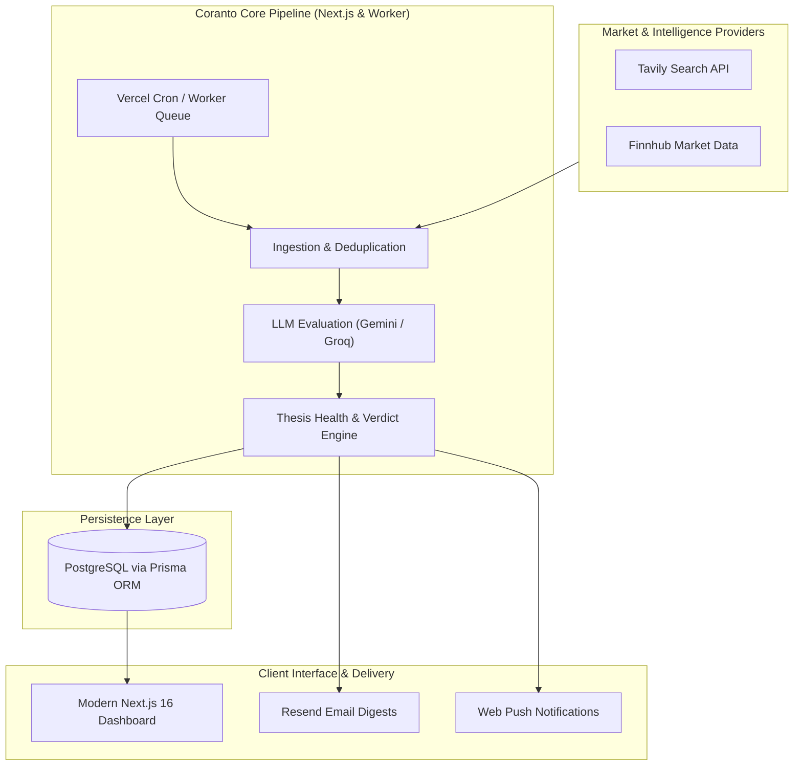

# Coranto | Portfolio Disruption Radar

**An intelligent portfolio monitoring and thesis disruption radar powered by multi-provider LLMs, automated financial intelligence pipelines, and real-time alerts.**

[Features](#key-features) • [Architecture](#architecture) • [Tech Stack](#tech-stack) • [Quick Start](#getting-started) • [Vercel Deployment](#deploying-to-vercel)

---

## Overview

**Coranto** is a full-stack investment intelligence platform designed to actively stress-test investment theses against real-time market data, company filings, earnings releases, and curated industry news.

Rather than passive portfolio tracking, Coranto functions as an automated research analyst:
- Formulates structured **falsification criteria** for each asset holding.
- Continuously ingests intelligence via **Tavily AI Search** and **Finnhub**.
- Analyzes potential thesis disruption using **Google Gemini** and **Groq** LLMs.
- Computes real-time **Thesis Health Scores** and delivers high-signal **Email & Web Push** alerts.

---

## Key Features

- **Autonomous Thesis Falsification**: Generates key vulnerability hypotheses and validation questions for every portfolio holding.
- **Multi-Source News & Filings Ingestion**: Scheduled background cron pipelines query live news, SEC filings, and market transcripts.
- **Two-Tier LLM Evaluation Engine**: High-throughput deduplication, clustering, and deep-dive disruption assessment leveraging Google Gemini & Groq.
- **Interactive Portfolio Radar Dashboard**:
  - **Live Ticker Tape & Earnings Radar**: Next-event earnings radar and financial ticker tracking.
  - **Thesis Health Panel**: Dynamic health scores, disruption severities (`INFO`, `LOW`, `MEDIUM`, `HIGH`, `CRITICAL`), and historical verdicts.
  - **AI Copilot**: In-context assistant to query holding risks and recent findings.
- **Automated Delivery & Alerting**:
  - Scheduled daily/weekly digests via **Resend**.
  - Browser **Web Push Notifications** for critical thesis alerts.
  - Cron automation integrated with Vercel Crons.

---

## Architecture

---

## Tech Stack

| Layer | Technologies |
| :--- | :--- |
| **Framework** | Next.js 16 (App Router), React 19, Server Actions |
| **Language & Styling** | TypeScript (Strict mode), Tailwind CSS v4, Lucide Icons |
| **Database & ORM** | PostgreSQL, Prisma ORM (`@prisma/adapter-pg`), `pg-boss` queue |
| **AI / Inference** | Google Gemini (`@google/genai`), Groq SDK (`groq-sdk`) |
| **Data Providers** | Finnhub API, Tavily Search API, MarketAux |
| **Auth & Security** | NextAuth.js v5 (Auth.js with Prisma Adapter), bcryptjs |
| **Alerts & Monitoring** | Resend, Web-Push (VAPID), Sentry |
| **Deployment** | Vercel (Frontend & Serverless Functions), Neon / Supabase (PostgreSQL) |

---

